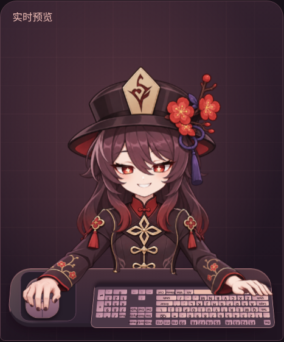

# 花影桌宠

一个置顶的透明桌宠。角色正坐在桌子中间，鼠标位于画面左侧，右侧的 104 键 QWERTY 键盘朝向角色。鼠标移动、点击和滚动会驱动鼠标手，打字会驱动键盘手并点亮对应按键区域。



## 安装

从 [GitHub Releases](https://github.com/MadridWen/desktop-pet/releases/latest) 下载对应的安装包。

| 系统 | 安装包 |
| --- | --- |
| Windows 10 / 11（x64） | `BlossomDeskPet-…-x64.exe` |
| macOS 13 及以上（Apple 芯片） | `BlossomDeskPet-…-arm64.dmg` |
| macOS 13 及以上（Intel 芯片） | `BlossomDeskPet-…-x64.dmg` |

macOS 用户请打开磁盘映像并将应用拖入「应用程序」。安装包使用临时签名，未经 Apple 公证，首次打开时可能需要在系统设置的「隐私与安全性」中点按「仍要打开」。Windows 安装程序没有商业代码签名。

## 使用

1. 第一次打开会显示设置。在「输入联动」中点击开启。macOS 还需要在「系统设置 → 隐私与安全性 → 输入监控」里允许 Blossom Desk Pet，返回应用后点「重新检测」。如果系统提示重新启动应用，请先退出桌宠再打开。
2. 拖动桌宠角色可以改变位置。点桌宠右下角的齿轮，或通过 Windows 托盘 / macOS 菜单栏图标，打开设置、隐藏或显示桌宠以及停用输入联动。
3. 在「外观」里分别替换头部、上半身、键盘手和鼠标手。支持单张 12 MB 以内的 PNG 或 JPEG。带透明背景的 PNG 可以保留部件边缘。每个部件都可以单独恢复默认。
4. 「桌宠大小」缩放整个桌宠窗口，包括桌面和设备。「人物大小」单独缩放角色，双手随姿势调整以保持对准键鼠。
5. 开启「鼠标穿透」后可以直接点击桌宠下方的窗口。要重新拖动桌宠，在托盘或菜单栏里关闭穿透即可。

Windows 使用 Raw Input，macOS 使用只读 Quartz 事件监听。键盘事件只转换为左、中、右和空格四种动画信号。应用不保存输入、不发送网络请求。设置和换装图片保存在本机，关闭联动、隐藏桌宠或锁屏时会停止监听。

## 开发

需要 Node.js 24、Python 3 和原生编译工具。Windows 使用 Visual Studio C++ Build Tools，macOS 使用 Xcode 命令行工具。

```sh
npm ci
npm run check
npm run build:native
npm start
```

在 Windows 运行 `npm run package -- --win --x64` 可生成 NSIS 安装程序。在目标架构的 Mac 运行 `npm run package -- --mac` 可生成 DMG。发布工作流使用原生 Windows、Intel Mac 和 Apple 芯片 Mac 分别构建，并把安装包和 SHA-256 校验清单上传到同一个 GitHub Release。

默认角色的头部、上半身和双手由项目提供的参考图生成。
